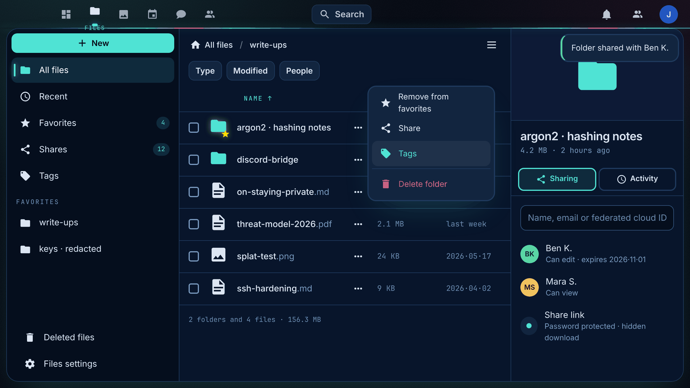

# InkCurity Dark for Nextcloud


_Ink. Privacy. Craft._ A one-of-a-kind dark theme for [Nextcloud](https://nextcloud.com) in the
InkCurity design language: a deep ocean-black page, ink-blue surfaces, one cyan accent, a magenta
guest star and a blinking cursor. Calm like iOS, playful where it counts.

Built on the [Breeze Dark theme](https://github.com/mwalbeck/nextcloud-breeze-dark) by Magnus
Walbeck. The app keeps the `breezedark` app id, so existing preferences stay valid.




## The design language

Two sources, one theme:

-   **InkCurity** gives the look: the ink scale (`#02060f` void, `#08152b` surfaces, `#1f3a5e`
    hairlines), the splash accents (`#4fe3d4` cyan, `#ff3d8e` magenta, `#f8e16c` lemon), glows
    instead of drop-shadows, mono labels set wide, redaction bars and the cursor.
-   **Trumpf** gives the manners: grouped lists on a sunk column, cells on the surface, hairlines
    instead of frames, at most one filled key per view, press feedback at 0.97, two easing curves
    for everything, and system settings (dark, reduced motion) always win.

What that looks like in Nextcloud:

| Where             | What                                                                                   |
| ----------------- | -------------------------------------------------------------------------------------- |
| Header            | A radar scan-line sweeps under the header. The active app carries a glowing cyan tick. |
| Navigation        | A sunk ink column; captions in mono; the active entry shows the brand's `▌` cursor.    |
| Buttons           | Keys, not lozenges: 10px corners. Primary is cyan with ink text and blooms on hover.   |
| Fields            | Sunk wells with a hairline that turns cyan on focus. Every caret is cyan.              |
| Menus and toasts  | Raised ink, hairline, soft cyan glow. Tooltips read like terminal tags.                |
| Modals            | The scrim removes the page instead of blurring it; the dialog floats on a cyan glow.   |
| Files             | Mono column headers, tabular dates and sizes, favourites in lemon with a glow.         |
| Dashboard         | Panels as hairline cards on the void; the greeting ends in a blinking cursor.          |
| Login             | The card glows, the headline blinks, the footer carries one redacted line.             |
| Reduced motion    | The sweep, the cursor and the press feedback stand still.                              |

No webfonts, no third-party requests: the theme ships everything it needs. Display and mono type
fall back to the system faces; install Space Grotesk and JetBrains Mono locally if you want the
full InkCurity look.

### The backdrop

The theme owns its backdrop. The body background image Nextcloud would show (the default shore
photo, a user's upload, a shipped wallpaper) is replaced by the ink void with a cyan bloom and
film grain. To bring a background image back, add this under **Custom styling** (see below):

```css
[data-themes*="breezedark"] #body-user,
[data-themes*="breezedark"] #body-settings {
    background-image: var(--image-background) !important;
}
[data-themes*="breezedark"] {
    --image-background: url("/apps/theming/img/background/kamil-porembinski-clouds.jpg") !important;
}
```

## Supported versions

This branch is a local compatibility fork for:

-   Nextcloud 33
-   Nextcloud 34

It is based on upstream Breeze Dark 29.0.0. The PHP integration, settings requests and Nextcloud
colour variables were ported to Nextcloud 33 and 34. Run the visual regression matrix in
[LOCAL_FORK.md](LOCAL_FORK.md) before enabling the theme on a production instance after a
Nextcloud major upgrade.

## Version numbering

This project follows semantic versioning. The major version number also follows the Nextcloud
version the release is intended for.

## Installation

Clone this repo into your app folder as `breezedark`, build the stylesheets and enable the app in
the app menu:

```
git clone https://github.com/InklingSplasher/nextcloud-breeze-dark breezedark
cd breezedark
npm ci && npm run build
```

`make appstore` builds the stylesheets and packs an unsigned tarball.

## Usage

After you install the theme, you need to enable it. There are two options for this, a global and a
personal one.

### Global

With the global options you can enforce the use of the theme for all users as well as
unauthenticated visits. Please note that when the theme is enforced for all users it isn't
possible for them to disable the theme or choose a different theme.

There is also an option to let the theme be enabled / disabled based on the theming preferences
reported by browser. When the theme is deactivated using this method, Nextcloud will revert to
using the default light theme. This setting only sets the default for when the theme is globally
enforced and can be overridden by the user.

You can also choose whether the login page should be themed. Though this only has an effect if the
theme is enforced globally, or during the login phase of a user that has the theme enabled.

You can find the global options here:

```
Settings > Administration > Theming > InkCurity Dark
```

### Personal

The personal option allows each user to enable / disable the theme unless it's being enforced by
the global options. They can though choose whether the theme should follow the theming choice
reported by the browser. This option is also available when the theme is being enforced globally.
If the user hasn't set a preference they will follow the global default. You can find the personal
option here:

```
Settings > Personal > Appearance and accessibility > InkCurity Dark
```

### Custom styling

Under the Theming section in the admin settings you can add your own custom styling to the theme.
Only standard CSS can be used. This custom styling will be applied whenever the theme is enabled
and only affects the InkCurity Dark theme.

## Development

```
npm ci            # toolchain
npm run build     # css/server*.css and css/guest*.css from the SCSS sources
npm run watch     # rebuild on change
npm run prettier  # formatting check (also runs in CI)
npm run stylelint
```

The tokens live in `css/variables/_tokens.scss` and are included once on the theme root for
logged-in pages and once on `:root` for the guest pages. The signature flourishes live in
`css/server/_signature.scss`; everything else follows the Nextcloud variables.

## Credits

-   [Breeze Dark for Nextcloud](https://github.com/mwalbeck/nextcloud-breeze-dark) by Magnus Walbeck
    and contributors, which this theme extends. If you like the foundation, consider supporting the
    upstream author.
-   The Breeze Dark colour scheme by the KDE Project, which inspired the original theme.
