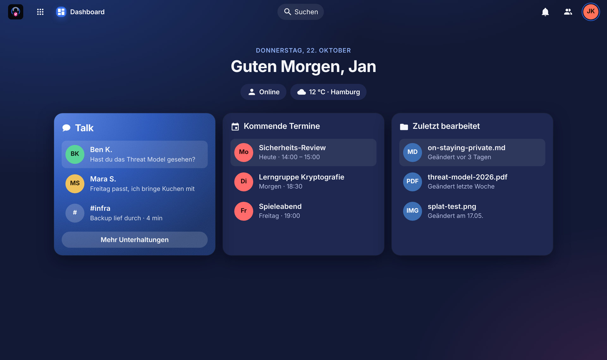
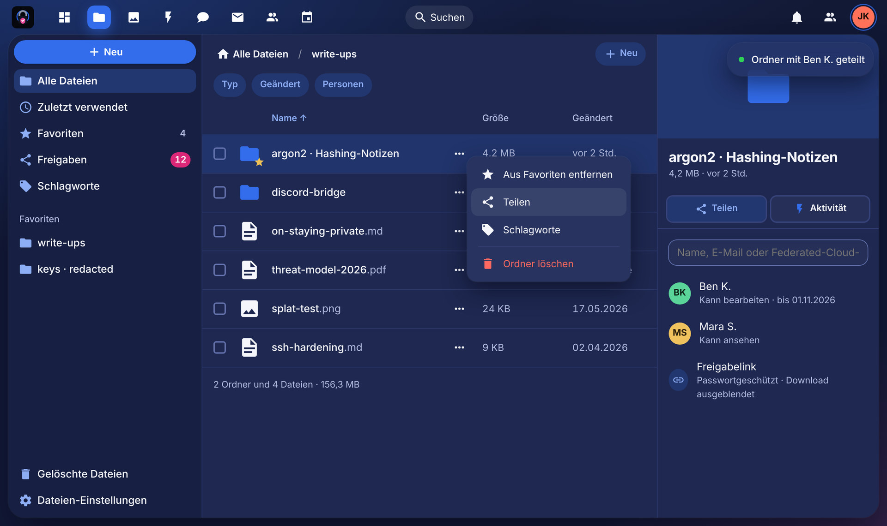
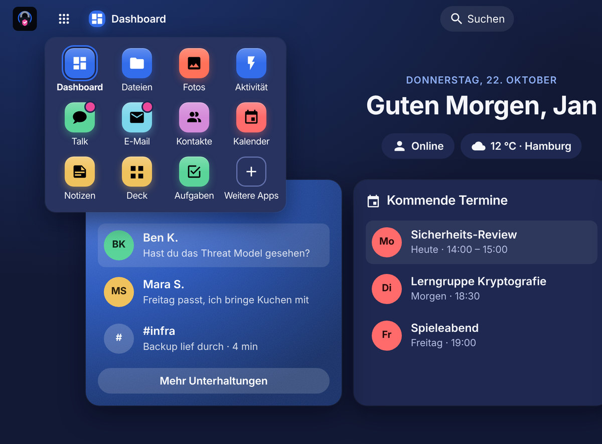
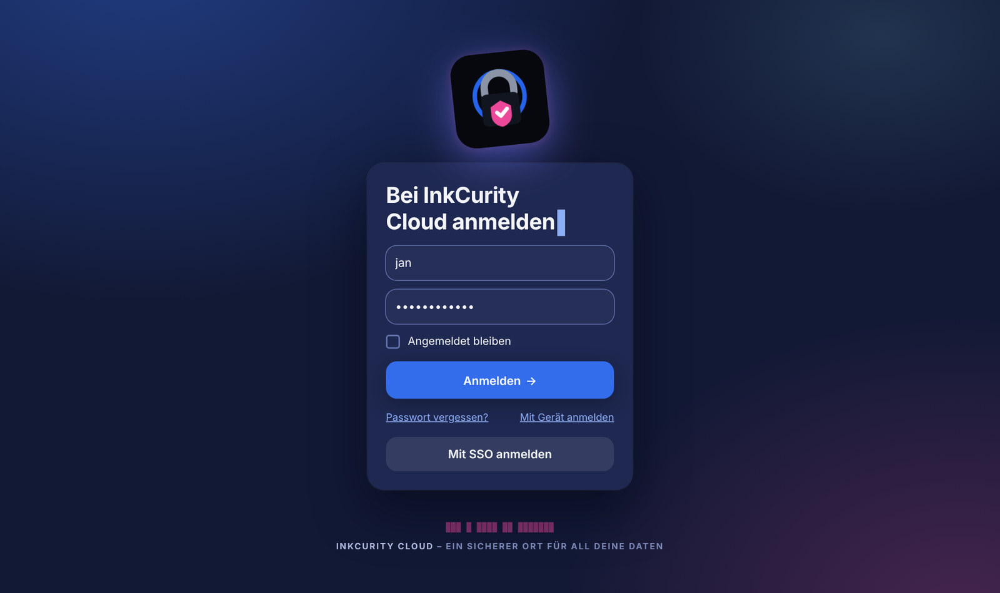
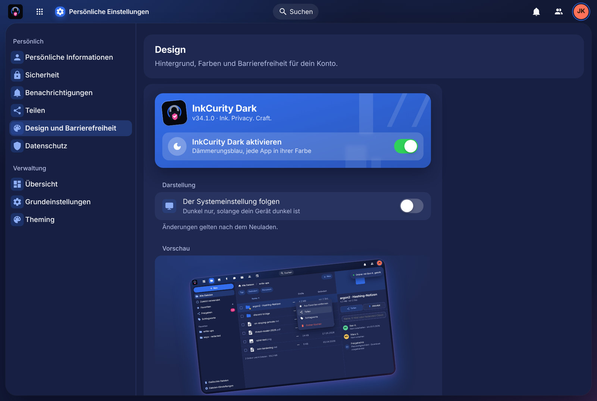

# InkCurity Dark for Nextcloud


_Ink. Privacy. Craft._ A one-of-a-kind theme for [Nextcloud](https://nextcloud.com): calm like
iOS, playful where it counts. Dusk blue instead of black, every app in its own colour, a large
greeting with today's date, a live card on the dashboard and confetti when you switch it on.

Built on the [Breeze Dark theme](https://github.com/mwalbeck/nextcloud-breeze-dark) by Magnus
Walbeck. The app keeps the `breezedark` app id, so existing preferences stay valid.



| Files                                          | App menu                                           |
| ---------------------------------------------- | -------------------------------------------------- |
|             |  |
| **Login**                                      | **Settings**                                       |
|             |  |

## The design language

The theme follows two design systems:

-   **Trumpf** sets the structure and the manners: page, bg, surface and inset as four surfaces,
    grouped lists, hairlines instead of frames, one filled button per view, tinted buttons and
    tiles, success green for switches, two motion curves, a press that shrinks to 0.97, and
    signature moments used sparingly.
-   **InkCurity** sets the identity: the logo, its blue and pink, the blinking cursor, a redacted
    line in the login footer and mono for code.

What that looks like in Nextcloud:

| Where          | What                                                                                     |
| -------------- | ---------------------------------------------------------------------------------------- |
| Palette        | Dusk blue (`#121935` page, `#1e2850` surface) instead of black. Text passes 4.5:1 or more. |
| Accent per app | Files and settings blue, Photos coral, Talk mint, Calendar red, Contacts orchid, Mail sky, Deck and Notes gold. The page bloom, buttons, selection and focus follow the open app. |
| App menu       | The open app sits on a tile in its colour (Nextcloud 33 bar). The Nextcloud 34 app grid shows every app as a coloured tile. |
| Dashboard      | Today's date as eyebrow above a large greeting. The first widget is the live card, the one saturated block of the page: drag the widget you need most into first place. |
| Navigation     | The Trumpf sidebar: tinted selection, icons in the accent, quiet counters, unread counts in pink. Settings get tinted icon tiles and cards. |
| Controls       | Pill buttons, 14 px keys for large ones, a light well for fields with a 2 px accent ring, switches in success green. |
| Overlays       | Menus float with a soft shadow, dialogs rise from below as sheets, toasts are material with a status dot. |
| Login          | The logo leans −6° like a Trumpf card and lands once, the headline ends in a cursor that blinks three times. |
| Theme settings | A hub page: hero card with the logo, the main switch as a frosted row, grouped switches, a tilted preview and confetti when you switch the theme on. |
| Motion         | Every app opens with a short fade and an 8 px rise. Reduced motion (system or Nextcloud) turns all of it off. |

No webfonts, no third-party requests: the theme ships everything it needs.

### The backdrop

The theme owns its backdrop. The body background image Nextcloud would show (the default shore
photo, a user's upload, a shipped wallpaper) is replaced by dusk blue with a bloom in the
colour of the open app. To bring a background image back, add this under **Custom styling**:

```css
[data-themes*="breezedark"] #body-user,
[data-themes*="breezedark"] #body-settings {
    background-image: var(--image-background) !important;
    background-size: cover !important;
}
[data-themes*="breezedark"] {
    --image-background: url("/apps/theming/img/background/kamil-porembinski-clouds.jpg") !important;
}
```

### Changing an app's colour

The colours live in `css/variables/_tokens.scss`: `$tr-accents` holds the contrast-checked
colour sets, `$tr-app-accents` assigns them to app ids. Add an app id there and run
`npm run build`.

## Supported versions

This branch is a local compatibility fork for:

-   Nextcloud 33
-   Nextcloud 34

It is based on upstream Breeze Dark 29.0.0. The PHP integration, settings requests and Nextcloud
colour variables were ported to Nextcloud 33 and 34. Run the visual regression matrix in
[LOCAL_FORK.md](LOCAL_FORK.md) before enabling the theme on a production instance after a
Nextcloud major upgrade.

## Version numbering

This project follows semantic versioning. The major version number also follows the Nextcloud
version the release is intended for.

## Installation

Clone this repo into your app folder as `breezedark`, build the stylesheets and enable the app in
the app menu:

```
git clone https://github.com/InklingSplasher/nextcloud-breeze-dark breezedark
cd breezedark
npm ci && npm run build
```

`make appstore` builds the stylesheets and packs an unsigned tarball.

## Usage

After you install the theme, you need to enable it. There are two options for this, a global and a
personal one.

### Global

With the global options you can enforce the use of the theme for all users as well as
unauthenticated visits. Please note that when the theme is enforced for all users it isn't
possible for them to disable the theme or choose a different theme.

There is also an option to let the theme be enabled / disabled based on the theming preferences
reported by browser. When the theme is deactivated using this method, Nextcloud will revert to
using the default light theme. This setting only sets the default for when the theme is globally
enforced and can be overridden by the user.

You can also choose whether the login page should be themed. Though this only has an effect if the
theme is enforced globally, or during the login phase of a user that has the theme enabled.

You can find the global options here:

```
Settings > Administration > Theming > InkCurity Dark
```

### Personal

The personal option allows each user to enable / disable the theme unless it's being enforced by
the global options. They can though choose whether the theme should follow the theming choice
reported by the browser. This option is also available when the theme is being enforced globally.
If the user hasn't set a preference they will follow the global default. You can find the personal
option here:

```
Settings > Personal > Appearance and accessibility > InkCurity Dark
```

### Custom styling

Under the Theming section in the admin settings you can add your own custom styling to the theme.
Only standard CSS can be used. This custom styling will be applied whenever the theme is enabled
and only affects the InkCurity Dark theme.

## Development

```
npm ci            # toolchain
npm run build     # css/server*.css and css/guest*.css from the SCSS sources
npm run watch     # rebuild on change
npm run prettier  # formatting check (also runs in CI)
npm run stylelint
```

The tokens live in `css/variables/_tokens.scss` and are included once on the theme root for
logged-in pages and once on `:root` for the guest pages. `css/server/_signature.scss` holds the
backdrop, the page entry and the type signatures, `css/server/_appmenu.scss` the app tiles, and
`css/settings.css` the self-contained settings hub. Selectors target `@nextcloud/vue` 9 as used
by Nextcloud 33 and 34, with the v8 class names kept for apps that still ship the old bundle.

## Credits

-   [Breeze Dark for Nextcloud](https://github.com/mwalbeck/nextcloud-breeze-dark) by Magnus Walbeck
    and contributors, which this theme extends. If you like the foundation, consider supporting the
    upstream author.
-   The Breeze Dark colour scheme by the KDE Project, which inspired the original theme.
